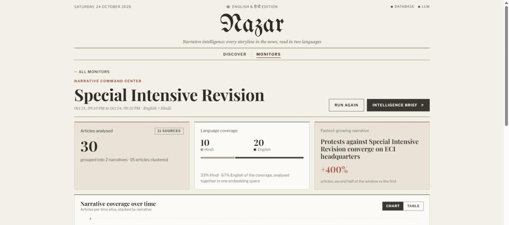
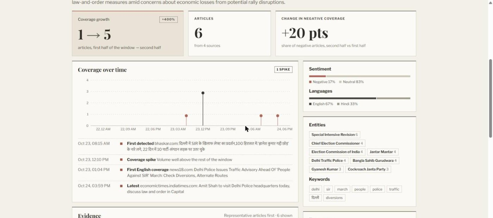
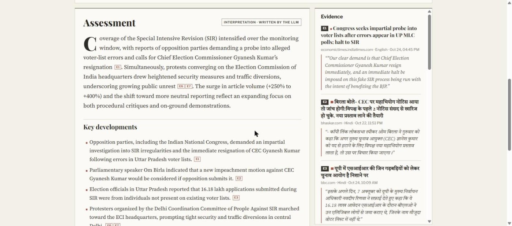
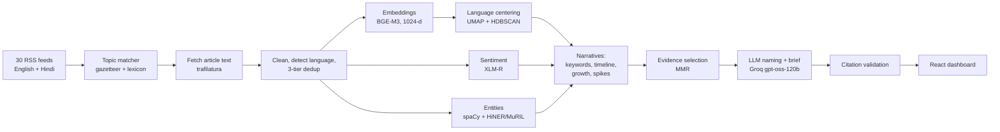

# Nazar: Multilingual Political Narrative Intelligence

**Nazar** (नज़र, "gaze") reads English and Hindi news about a political story, groups the coverage into the *narratives* being told, measures how each one grows, spreads and shifts in tone, and writes an intelligence brief in which every claim cites an article.


## What it does

1. **Pick a story.** The home page suggests topics that are in the news right now with real coverage in both languages, so a run doesn't come back empty.
2. **Collect.** Nazar reads 30 publisher RSS feeds (English and Hindi), keeps the articles that match the topic, fetches their full text, and removes duplicates and syndicated copies.
3. **Understand.** Local models embed every article in one multilingual space, classify its sentiment, and find the people, organisations and places it names.
4. **Cluster into narratives.** Articles telling the same story are grouped across both languages. A Hindi article and an English one about the same development land in the same narrative.
5. **Measure.** For each narrative: volume, growth, spikes, sentiment shift, language split, top sources and entities.
6. **Brief.** An LLM names each narrative and writes an assessment. Every claim must cite evidence, citations are validated in code, and unsupported statements are struck out and shown as removed.

| Discover | Monitor |
|---|---|
|  |  |
| **Narrative** | **Brief** |
|  |  |

## How it works



**Key ideas**
- **Language centering.** Multilingual embeddings still cluster partly by language. Subtracting each language's mean vector before clustering removes that bias: 12 of 12 narratives contained both languages, versus 3 of 13 without it.
- **Local models for analysis, an API for writing.** Embeddings, sentiment and NER run on the local GPU (about 3 GB of models). The LLM is only used to name narratives and write the brief, and its responses are cached.
- **Grounded generation.** The brief is generated against a JSON schema, its `[E#]` citations are checked against the evidence actually provided, and prompts are trimmed to fit the free-tier token budget.
- **Measured, not generated.** Growth, sentiment and language shares are computed from the data and shown separately from the LLM's interpretation.

## Tech stack

| Layer | Tools |
|---|---|
| Backend | Python 3.11, FastAPI, SQLAlchemy 2, Pydantic, SQLite (Postgres + pgvector supported) |
| Ingestion | httpx, feedparser, trafilatura, lingua (language ID) |
| NLP models | `BAAI/bge-m3` embeddings, `cardiffnlp/twitter-xlm-roberta-base-sentiment`, spaCy `en_core_web_sm`, `cfilt/HiNER-collapsed-muril-base-cased` |
| Clustering | UMAP, HDBSCAN, c-TF-IDF keywords, MMR evidence selection |
| LLM | Groq (`openai/gpt-oss-120b`) with JSON-schema output, retries and a response cache |
| Frontend | React 19, TypeScript, Vite, TanStack Query, React Router, Recharts |
| Tooling | uv, pytest, oxlint |

## Evaluation

All numbers come from `uv run python -m evaluation.run_eval`. Details and caveats are in [docs/evaluation.md](docs/evaluation.md).

| Component | Benchmark | Result |
|---|---|---|
| Hindi NER | Naamapadam test (Hindi news, unseen) | **F1 0.793** |
| English NER | CoNLL-2003 test | F1 0.592 (organisations are the weak spot) |
| Sentiment | IndicSentiment, same items in English / Hindi | accuracy 0.809 / 0.675 |
| Sentiment | Financial PhraseBank (news sentences) | macro-F1 0.457 vs 0.254 baseline |
| Clustering | real run, 152 articles | silhouette 0.180 vs 0.157 for KMeans; 100% bilingual narratives vs 23% without centering |
| Brief | 3 generated briefs, 42 claims | 100% of claims cite real evidence |

**Known limitations:** the sentiment model, trained on tweets, labels most news as neutral, so sentiment is best read relatively (narrative vs narrative, English vs Hindi). English organisation NER is weak. The feeds only hold the last 1 to 3 days of news, so older or niche topics may not have enough coverage.

## Setup

Requirements: Python 3.11+ with [uv](https://docs.astral.sh/uv/), Node 20+, and ideally an NVIDIA GPU (CPU works, more slowly).

```bash
cp .env.example .env                       # then add your GROQ_API_KEY
uv sync                                    # backend dependencies
uv run uvicorn backend.main:app --reload   # API on http://localhost:8000
cd frontend && npm install && npm run dev  # UI on http://localhost:5173
```

- **LLM:** create a free key at https://console.groq.com/keys and set `GROQ_API_KEY` in `.env`. Without it, analysis still runs and narratives keep their most representative headline as a title.
- **Database:** SQLite by default (`data/nazar.db`, created automatically). For Postgres with pgvector, set `DATABASE_URL` and run `uv sync --extra postgres`.
- **Models** download on first use. The server keeps them loaded between runs (`KEEP_MODELS_LOADED=true`, about 2.5 GB of GPU memory).
- **Status:** `GET /health` and the masthead show whether the database and the LLM are reachable.

A run can also be started without the UI:

```bash
uv run python -m pipeline.run --topic "Special Intensive Revision" --hours 72
```

Each run logs its stages, timings and where the articles went to the terminal and to `data/logs/nazar.log`.

## API

| Method | Path | Purpose |
|---|---|---|
| `GET` | `/trending` | Topics in the news now, with English/Hindi coverage counts |
| `POST` | `/monitors` | Create a monitor (topic, window, languages) and start a run |
| `GET` | `/monitors`, `/monitors/{id}` | Monitors and their latest run, including live progress |
| `POST` | `/monitors/{id}/run` | Run again |
| `GET` | `/monitors/{id}/narratives`, `/monitors/{id}/timeline` | Narrative cards and coverage over time |
| `GET` | `/narratives/{id}`, `/narratives/{id}/evidence`, `/narratives/{id}/related` | One narrative in depth |
| `POST`/`GET` | `/monitors/{id}/brief` | Generate or fetch the intelligence brief |

## Project layout

```
backend/     FastAPI app: routes, schemas, database models, pipeline services
pipeline/    ingestion, cleaning, language, embeddings, sentiment, entities,
             clustering, temporal stats, evidence, LLM naming and briefs
evaluation/  public-benchmark, clustering and brief evaluation
frontend/    React + TypeScript dashboard
docs/        evaluation results and the development journal
tests/       pytest suite
```

## Tests

```bash
uv run pytest
```

## License

MIT
